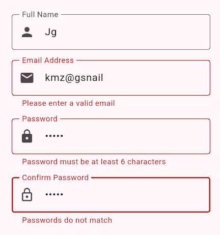
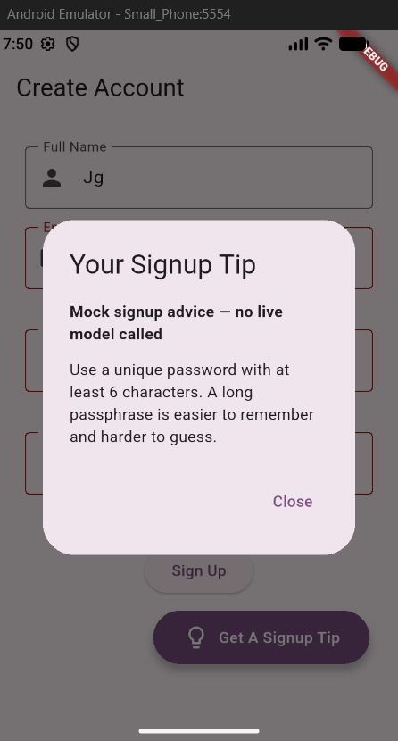
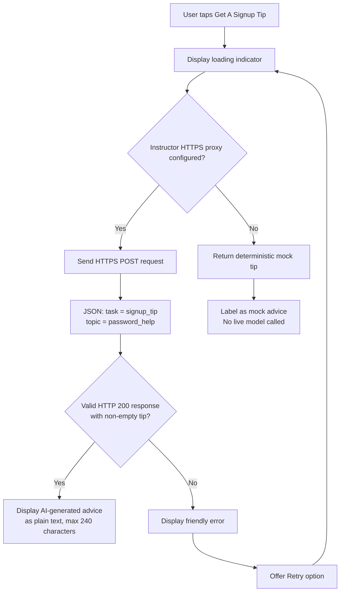
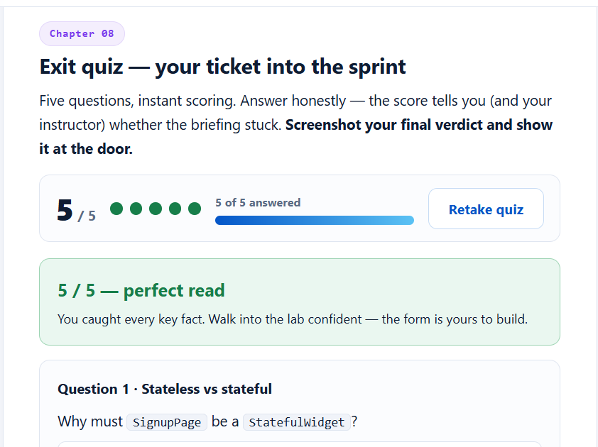

# Sign Up Form
Janiya Green
Undergraduate Track
Github Repo Link: https://github.com/xxklusivenana/signup_app/tree/main/signup_app

## Concept Questions
1. Name the exact information your request sends and one piece of information it deliberately does not send. Why?
- The request sends two fields in JSON format: "task": "signup_tip" and "topic": "password_help".
- It deliberately doesn't send the user's name, email address, password, or any identifying information. This protects the user's privacy as the AI only needs to know enough to provide password advice. It should never need to know any of the user's personal information.
2. Why must the app keep form validation local even when it can ask an AI for a tip? Give one example of a bad decision if AI were allowed to approve signup.
- The app must keep form validation local because validation needs to be consistent, predictable, and independent of the AI service or internet connection. The AI coach is only meant to provide advice and shouldn't decide whether an account can be created. 
- One example: if AI were allowed to approve signup, it might approve two passwords that don't match, allowing the user to continue with incorrect information.

## AI Response
| # | Successful Response | Failure/Offline State |
| - | ------------------- | --------------------- |
| **input** |  | X |
| **after** |  | If the request times out, the server returns a non-200 status, the JSON is invalid, or the tip is empty, the app displays a friendly error message and a Retry option. If no instructor-provided HTTPS proxy URL is configured, the app displays deterministic mock advice labeled Mock signup advice — no live model called. |

## Request Flow and Privacy Choice

**Privacy choice:** The request never includes the user's name, email address, password, or confirm-password value. No provider API keys or real credentials are stored in the app. The AI coach only provides optional advice and does not change form values, approve signup, or replace local validation.

## Exit Quiz

